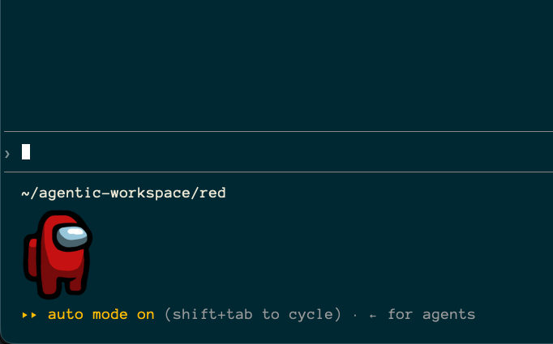
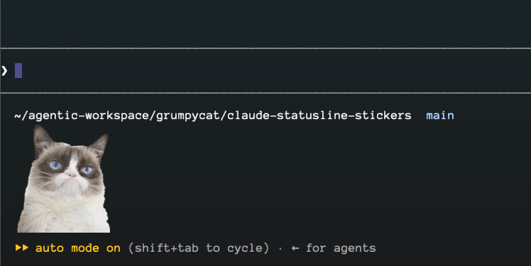
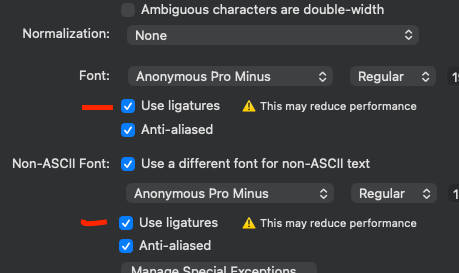
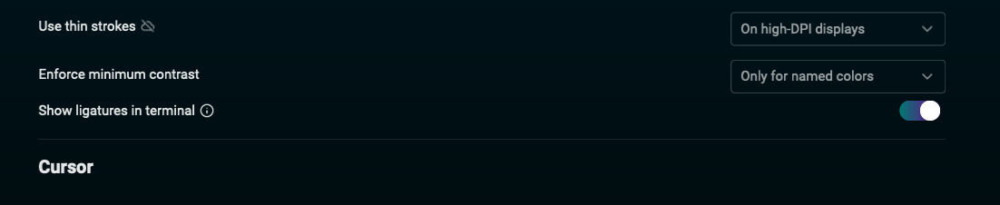

# Claude StatusLine Stickers

Full-colour **sticker art in the Claude Code statusline** — one per agent.
A few themes ship built in; add your own with a small JSON file.



The statusline only allows plain text + ANSI colour, and every real terminal
image protocol (iTerm2 OSC 1337, kitty, sixel, DECDHL) is stripped by Claude
Code's escape filter. The trick: each sprite is a **single font glyph** carrying
an Apple `sbix` colour bitmap (the Apple Color Emoji mechanism), at a
Private-Use-Area codepoint, installed as a **fallback-only** font macOS resolves
automatically. A glyph is text, so it passes the filter.

## How it works

```
themes/<name>/theme.json   bundled sprite list (name, key, url, agentNames) + optional emoji probe
        │  stickers fetch   ── downloads each sprite from its URL → work dir (256²)
        ▼
     stickers build         ── packs EVERY theme into ONE font, each at its own PUA range
        │                      → <work>/build/all/  (.ttf + font_<theme>_<key>.txt + manifest.json)
        ▼
     stickers install       ── font → ~/Library/Fonts, cache → ~/.claude/claude-statusline-stickers,
        │                      statusline script → ~/.claude/stickers-command.sh, settings.json wired
        ▼
 stickers-command.sh        ── resolves the AGENT (the folder above the project dir) against
                               manifest.json and cats that sprite's glyph text
```

The font is **fallback-only**: your terminal's primary font is untouched; macOS
finds `ClaudeStatusLineStickers` for the unmapped PUA codepoints. **Ligatures
must be ON** in the terminal — only the full shaping path resolves fallback
fonts. All themes ship in one font, so switching agent switches the sticker with
no reinstall.



## Ligatures

### iterm2


### Warp


## Requirements

- **macOS** (sbix colour glyphs via CoreText) with **Warp** or iTerm2
- **Python 3.10+** — the `stickers` CLI; deps `fonttools` + `pillow` install with it
- `jq` (used by the statusline script)
- terminal with **ligatures ON**

## Install

### Homebrew (tap)

```bash
brew install rntgspr/tap/claude-statusline-stickers
```

### From source (pipx / pip)

```bash
git clone <repo-url> claude-statusline-stickers && cd claude-statusline-stickers
pipx install .          # or: python3 -m pip install .
```

Either way you get the `stickers` command **with the eight themes bundled** — nothing
to download by hand. The pipeline then fetches each theme's sprites (third-party PNGs,
not shipped in the package), builds the font, and wires it live:

```bash
stickers fetch      # download every theme's sprites → work dir
stickers build      # pack all themes into one font   → <work>/build/all/
stickers install    # font + cache + statusline script live, and wires settings.json
```

`stickers install` also points `~/.claude/settings.json` (`statusLine.command`) at the script, backing it up first. Pass `--no-settings` to skip and add it by hand:

```json
{ "statusLine": { "type": "command", "command": "bash ~/.claude/stickers-command.sh" } }
```

Finally: enable **ligatures** and **Cmd+Q** the terminal once so it picks up the
new font. (The sticker only shows in a dir named after an agent — see below.)

## Themes & agents

Eight themes are bundled (`pokemon`, `southpark`, `amongus`, `memes`,
`powerrangers`, `cars`, `smurfs`, `zootopia`), so a fresh install works with
zero setup —
`stickers fetch` just pulls their sprites. The sticker shown is chosen by the
**agent** — resolved from the **project dir itself** or the **folder right above
it** (`…/agentic-workspace/<agent>/<project>`), the current dir winning on
conflict. Each sprite in a `theme.json` declares `agentNames`, and the build
compiles a manifest mapping agent → sprite. A dir matching no agent (and not
under `agentic-workspace`) shows no sticker. The full list is at the bottom:
[Bundled agent names](#bundled-agent-names).

### Add your own theme

1. Create a `theme.json` under the work dir
   (`$STICKERS_HOME/themes/<name>/`, default `~/.cache/claude-statusline-stickers/themes/<name>/`):
   ```json
   {
     "name": "<name>",
     "codepointSlot": 9,
     "sprites": [
       { "name": "hero", "key": "hero", "url": "https://…/hero.png", "agentNames": ["hero"] }
     ]
   }
   ```
   `codepointSlot` is the theme's permanent home in the PUA — pick a number no
   other theme uses (bundled themes take 1–8; slot 0 is the probe glyphs). It is
   what keeps a theme's sprites at the same codepoints when other themes come and
   go, so the terminal's cached font can never draw the wrong one. A missing or
   duplicated slot fails the build by name. `agentNames` must be unique across
   *all* themes too — the manifest is one flat agent→sprite map.
2. `stickers fetch --theme <name>` (or `stickers fetch` for all).
3. `stickers build && stickers install`.

A sprite with **no `url`** is "bring your own": drop `<key>.png` in that theme's
work folder yourself and the build uses it as-is.

## Tuning the sticker size

The pixel ruler is calibrated for **Warp + Anonymous Pro 20, line-height 2.2**
(1 column ≈ 31.7 px, 1 row ≈ 127.6 px). A different primary font / size / line
height shifts it — adjust `CELL_SCALE_Y` (and re-measure) in
`claude_statusline_stickers/config.py`. To see your terminal's grid run
`stickers probe`: ruler bars (`h1…h28`, `v1…v7`) and a 32×8 grey sheet.

## Renderer facts (measured, Warp on macOS)

- Glyph ink overflows ~28 cells **right** and 7+ rows **up** of the anchor without
  clipping; ink **left** of the anchor IS clipped — so anchor at column 0 and
  extend right.
- TrueType outline coords cap at ±32767 units; the `sbix` bitmap ignores the cap.
- `sbix` bitmaps draw at **natural pixel size** (the units box only shapes the
  fallback outline) — size the image first, then derive cells.
- Engines without `sbix` get the traced monochrome outline, tintable via ANSI.
- Stale font after a rebuild: **Cmd+Q** the terminal. If it resolves to
  `.LastResort`, run `atsutil databases -removeUser`. A stale font can only ever
  show *nothing* for a theme it has not seen — never another theme's sprite —
  because each theme's codepoints are pinned to its `codepointSlot`.

## Credits & licence

Code: **MIT** — see [`LICENSE`](LICENSE). The sprite art belongs to its owners —
Pokémon HOME, [OpenMoji](https://openmoji.org), [StickPNG](https://www.stickpng.com) —
and is **downloaded locally by `stickers fetch`, never redistributed in this
repo**. The skeleton font (Anonymous Pro, © Mark Simonson, OFL) is used only for
its cell metrics; no glyph of it ships in the output.

## Bundled agent names

Name the dir (or its parent) after one of these and the matching sticker shows.
Names are unique across every theme, so you never pick a theme — the name alone
resolves it.

| Theme | Agent names |
|---|---|
| `pokemon` | `bulbasaur` `charmander` `blastoise` `pikachu` `vulpix` `psyduck` `tauros` `pokeball` `charizard` `gyarados` `eevee` `mewtwo` `mew` `snorlax` `gengar` `squirtle` `meowth` `jigglypuff` `magikarp` `ditto` `dragonite` |
| `southpark` | `cartman` `kenny` `butters` `chef` `clyde` `craig` `damien` `citywok` |
| `amongus` | `red` `green` `cyan` `yellow` `crew` `logo` |
| `memes` | `doge` `grumpycat` `harambe` `badluck` `pepe` `justdoit` `gaben` `gabedog` |
| `powerrangers` | `megared` `megablue` `megablack` `megapink` `megagreen` `megayellow` `rangers5` `rangers6` |
| `cars` | `mcqueen` `lightning` `ramon` `flo` `francesco` `schnell` `finn` `bobby` `snotrod` `king` `carslogo` |
| `smurfs` | `papa` `smurfette` `brainy` `clumsy` `hefty` `grouchy` `gutsy` `vanity` `smurf` `blossom` `lily` `melody` `storm` `vexy` `hackus` `gargamel` |
| `zootopia` | `judy` `nick` `bogo` `clawhauser` `bellwether` `doug` `finnick` `flash` `gazelle` `lionheart` `mrbig` `otterton` `priscilla` `yax` `zoologo` |

The Power Rangers carry a `mega` prefix because `red`, `green`, and `yellow` are
already Among Us — a duplicate `agentNames` entry fails the build outright. Same
reason `cars` has `carslogo` rather than `logo`. In `cars`, `mcqueen` and
`lightning` are the same character from two angles, and `bobby` is the Cars 2
British police car. `smurfs` ships one sprite per character — StickPNG also
carries the same characters in other poses, which would only produce agent names
that mean nothing as a folder name. `smurf` is the generic, unnamed one. Same
for `zootopia`; `zoologo` avoids Among Us's `logo`, and `finnick` (the fennec) is
a different animal from `finn` (the Aston Martin).

To see what the current build actually resolves:

```bash
jq -r '.agents | to_entries[] | "\(.value.theme)\t\(.key)"' \
  ~/.claude/claude-statusline-stickers/manifest.json | sort
```
